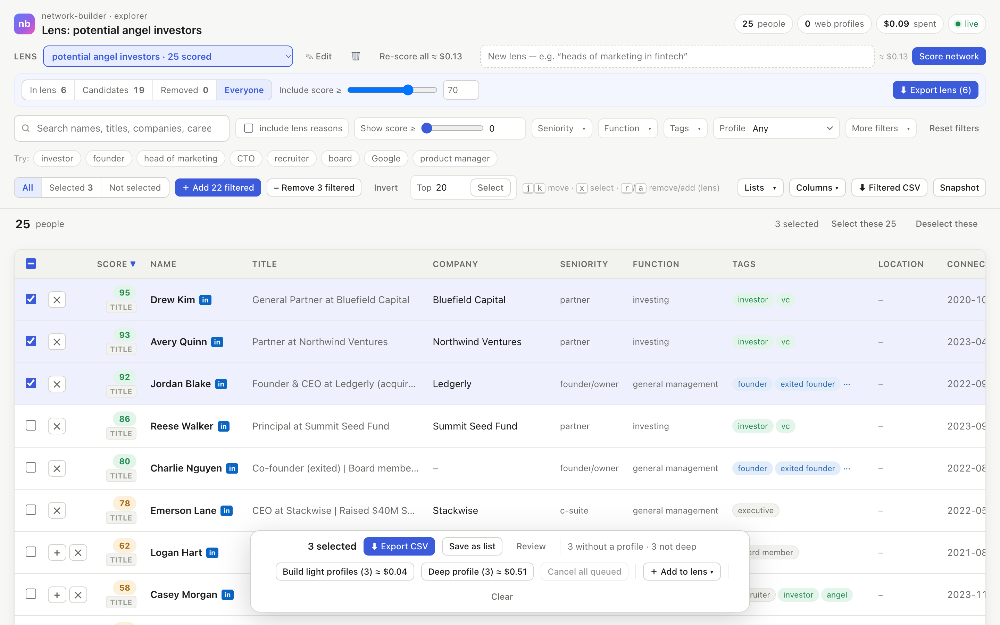
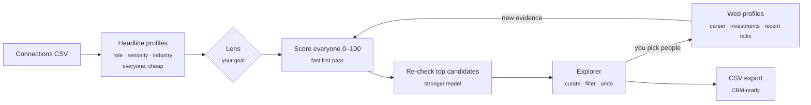

<div align="center">

# network-builder

### Your LinkedIn network, turned into lists you can act on.

Find the **angel investors**, **buyers**, **hires** and **journalists** already in your network.<br>
Describe who you're looking for and AI scores every connection. Then refine the list yourself and export it.

[](https://github.com/lyonsv/network-builder/releases)
[](https://github.com/lyonsv/network-builder/actions/workflows/ci.yml)
[](https://nodejs.org)
[](LICENSE)
[](#-privacy)

```bash
npx github:lyonsv/network-builder
```

<picture>
  <source media="(prefers-color-scheme: dark)" srcset="docs/explorer-dark.png">
  
</picture>

<sub>Shown with made-up example data.</sub>

</div>

---

You probably have a few hundred, or a few thousand, LinkedIn connections. Somewhere in there are the people who could
fund your startup, buy your product or introduce you to your next hire. Finding them means scrolling and guessing.

**network-builder does the reading for you.** Import your connections and describe a goal, such as *"potential angel
investors"* or *"heads of finance at 50–500 person SaaS companies"*. Every person gets a 0–100 fit score with a
one-line reason. Scores are based on evidence, not keywords: a recruiter with "Angel Investor" in their headline won't
outrank a partner at a fund. Then you curate the list in a fast local web app and export it to your CRM.

## ✨ Features

- 🎯 **Lenses: score everyone for any goal.** You write the goal in plain English, and each lens is saved. Build as
  many as you like (investors, customers, hires, press) over the same network.
- 🧠 **Evidence over keywords.** A cheap first pass covers everyone, then a stronger model re-checks the top
  candidates. Exits, fund roles, board seats and named investments count; buzzwords don't.
- 🔎 **Web profiles when you want them.** For the people you pick, it looks them up on the web: career history,
  investments, boards and **what they've been talking about lately** (podcasts, talks, articles). Nothing is
  researched unless you ask.
- ✂️ **Curate fast.** In lens / Candidates / Removed tabs, a score cut-off slider, one-click add and remove, keyboard
  shortcuts (`j` `k` `x` `r` `a`), bulk actions on whatever you've filtered, and undo everywhere.
- 📤 **Export to your CRM.** HubSpot/Salesforce-friendly CSVs, an **Ahoy** import bundle (companies, contacts and
  notes), or every field. Save named lists to revisit later.
- 🔐 **Local-first.** One SQLite file on your machine. The web app runs on `127.0.0.1` with a per-session token.
- 🔑 **No API key.** All AI runs through your existing [Claude Code](https://claude.com/claude-code) login.

## 🚀 Quick start

**1. Install Claude Code and log in** (one time):

```bash
npm install -g @anthropic-ai/claude-code
claude          # log in with your Claude account, then exit
```

**2. Export your LinkedIn connections** to a CSV. [Here's how](#-getting-your-connections), which takes a few minutes.

**3. Run it:**

```bash
npx github:lyonsv/network-builder
```

The first run walks you through setup:

```text
┌  network-builder
│
◇  Welcome to network-builder
│    1. Import your connections (a CSV)
│    2. Pick a goal ("lens"): everyone gets a 0–100 fit score with a reason
│    3. Review in your browser: add/remove people, look up the ones you care about, export
│
◆  Claude Code 2.x · logged in
◇  Import your LinkedIn connections › I have a CSV › linkedin-connections-2026-11-04.csv
◇  What list do you want to build first? › Potential angel investors
◇  Ready to go
│    Import 1,842 people and read their headlines                       ≈ $0.37
│    Score everyone for "potential angel investors"                     ≈ $1.30
◆  Start? Yes
│
└  Opening the explorer → http://127.0.0.1:47321/?t=…
```

> **Needs Node.js 22.13+** (`node --version`). The first `npx` run takes a minute while it downloads and builds. If you
> prefer a permanent install, run `npm install -g github:lyonsv/network-builder`
> and then `network-builder`.

## 📥 Getting your connections

| Source | How | You get |
|---|---|---|
| **Chrome extension** · fastest | Install [**chrome-linkedin-connections-exporter**](https://github.com/lyonsv/chrome-linkedin-connections-exporter): clone it, open `chrome://extensions`, turn on Developer mode, then **Load unpacked**. Open your LinkedIn connections page, click the extension, then **Start export**. Keep the tab in the foreground. | Name, headline, connection date, profile URL |
| **LinkedIn's own export** | **Settings → Data privacy → Get a copy of your data → Connections**. The file arrives by email, usually within an hour. | First and last name, company, position, connected on, URL |
| **Any CSV** | Lead lists from other tools work too. Name and title columns are detected automatically. | Whatever columns it has |

Import more files any time. Repeat imports merge, adding new people and refreshing titles:

```bash
network-builder import ~/Downloads/Connections.csv
```

## 🧭 How it works



| | What it is | Approx. cost* |
|---|---|---|
| **Headline profiles** | Each headline is parsed into company, role, seniority, function, industry and tags. Everyone gets one, and results are cached. | $0.20 per 1,000 people |
| **Lenses** | A goal scored across your whole network, with a reason for every score. | $0.30 per 1,000 + $0.50 per 100 re-checked |
| **Light web profile** | 2 web searches: who they are, roles, investments, boards. | ≈ $0.02 per person |
| **Deep web profile** | Up to 8 searches: full career, investments, boards, plus **recent activity and themes**. | ≈ $0.17 per person |

<sub>*All AI runs through `claude -p` on your Claude subscription, so usage counts against your plan's limits and there's
no separate bill. Dollar figures are API-equivalent estimates so you can compare actions before you run them.</sub>

When someone gets a new web profile, their scores are marked **stale**. **↻ Update stale** re-scores just those people.

### 💡 Lens ideas

| Goal | Write it like this |
|---|---|
| Fundraising | `potential angel investors` |
| Sales | `potential customers: heads of finance at 50–500 person SaaS companies` |
| Hiring | `senior backend engineers and engineering managers who could join or refer` |
| Press | `buyers of newsroom software: editors-in-chief, heads of digital at publishers` |
| Advisors | `founders who have sold a company` |

Be specific. *"Buyers of newsroom software"* finds decision makers; *"media people"* finds everyone who has ever
written a blog post.

## 🖥️ Using the explorer

The explorer is a local web page served by the CLI. Keep the terminal open while you use it, and press **Ctrl-C** when
you're done.

- **Search everything.** Search names, titles, companies, past employers, investments, and what people are "talking
  about". Filter by seniority, function, tags, location, connection date or profile status. A results bar shows the
  count and your active filters, each with a × to clear it.
- **Curate a lens.**
  - Use the **In lens**, **Candidates**, **Removed** and **Everyone** tabs, and set the cut-off with **Include score ≥**.
  - On each row, **✕** removes, **＋** adds and **↺** restores (keyboard: `r` / `a`).
  - Filter to a group, then **Remove these N** or **Add these N**.
  - People you remove stay out, even after a re-score.
- **Add people to any lens.** Select them, then use **＋ Add to lens ▾**. It works whichever lens you're viewing, and it
  asks before touching selected people your filters are hiding.
- **Research.** Select people, then click **Build light profiles** or **Deep profile**. The queue runs in the background,
  respects web-search rate limits, and resumes on its own.
- **Export.** **⬇ Export lens**, or select people and click **Export CSV**. There are three formats:
  - **CRM**: HubSpot/Salesforce-friendly columns.
  - **Full**: every field.
  - **Ahoy CRM import**: separate Companies, Contacts and Notes CSVs using [Ahoy](https://ahoy.ai)'s field names, with
    names split and cleaned and each contact linked to its company by exact name.

  **Save as list** keeps a named list for later.
- **Reword a lens.** **✎ Edit** re-scores it with your new description and keeps your manual adds and removes.

## 🔐 Privacy

- **Your data stays on your computer**, in `~/.network-builder/`:
  - `network.db` (SQLite)
  - `outputs/` (exports)
  - `dossier.md` (what web profiles capture, which you can edit)
- To keep data somewhere else, set `NETWORK_BUILDER_HOME`.
- **What leaves your machine:** only the AI calls Claude Code makes on your behalf. Headlines go to Claude for scoring,
  and names, titles and companies go into web searches for the profiles **you** start.
- The local server listens on `127.0.0.1` only, checks Host and Origin, and needs a per-session token. Other websites
  can't trigger paid work.
- Your connections are personal data. Use exports responsibly and in line with LinkedIn's terms and your local privacy
  law.

## 📚 Reference

<details>
<summary><b>Commands</b></summary>

| Command | What it does |
|---|---|
| `network-builder` | Open the explorer (runs the guided setup if you have no data yet) |
| `network-builder import <csv> [-p "goal"]` | Import or refresh people from a CSV, and optionally score a lens |
| `network-builder -p "goal"` | Create a lens from the terminal (or update stale scores), then open it |
| `network-builder lists` | Show saved lists |
| `network-builder export --list <name> [--preset crm\|full\|ahoy] [-o file.csv]` | Export a saved list to CSV (`ahoy` writes companies, contacts and notes files) |
| `network-builder lens list` | Lenses with scored and stale counts |
| `network-builder lens rescore <id\|goal> [--stale] [--rerank-top N] [-y]` | Re-score a lens |
| `network-builder lens rm <id\|goal>` | Delete a lens and its scores |
| `network-builder db` | Database stats and total spend |

</details>

<details>
<summary><b>Options</b></summary>

| Option | Default | |
|---|---|---|
| `-i, --input <csv>` | | Import a CSV, then open the explorer |
| `--db <path>` | `~/.network-builder/network.db` | Database file |
| `-o, --out-dir <path>` | `~/.network-builder/outputs` | Exports and snapshots |
| `--dossier <path>` | `~/.network-builder/dossier.md` | What web profiles capture |
| `--research-model <model>` | `sonnet` | Model for deep profiles and lens re-checks |
| `-c, --concurrency <n>` | 2 | Deep profiles in parallel |
| `--light-concurrency <n>` | 3 | Light profiles in parallel (web search is rate-limited, so raise with care) |
| `--rerank-top <n>` | 150 | For new lenses: how many top candidates get the closer re-check (0 = off) |
| `--no-open` / `--port <n>` | | Don't open the browser / use a fixed port |
| `--no-serve` | | Import or score, then exit without opening the explorer |
| `--dry-run` | | Show what would happen without calling or writing anything |

</details>

<details>
<summary><b>Troubleshooting</b></summary>

- **"Claude Code CLI not available" or "not logged in"**: run `npm i -g @anthropic-ai/claude-code`, then `claude` once
  to log in. Check that `claude --version` works in the same terminal.
- **"needs Node.js 22.13 or newer"**: network-builder uses Node's built-in SQLite. Upgrade from
  [nodejs.org](https://nodejs.org) or run `nvm install --lts`.
- **Profiles show "paused (rate limit)"**: web search is rate-limited on your plan. The queue backs off and resumes on
  its own. If it keeps hitting the limit, it waits for you to click **Resume**.
- **"Identity not confirmed" on a light profile**: two searches weren't enough, which is common for less public people.
  Use a deep profile for people who matter, or add them to a lens by hand.
- **Explorer "already running"**: another network-builder is open on the same database. Use the URL it prints, or stop
  it with Ctrl-C.
- **Windows**: not tested yet. macOS and Linux are supported.

</details>

## 🛠️ Development

```bash
git clone https://github.com/lyonsv/network-builder && cd network-builder
pnpm install
pnpm dev                 # run from source
pnpm test                # vitest
pnpm typecheck && pnpm build
```

- **The explorer UI** is a single dependency-free HTML file (`src/web/explorer.html`), served by a small `node:http`
  server.
- **AI calls** go through `claude -p` with JSON schemas (`src/llm/`).
- **Specs:** `src/web/CONTRACT.md` documents the API and data model.

Issues and pull requests are welcome.

## License

[MIT](LICENSE) © Vincent Lyons
