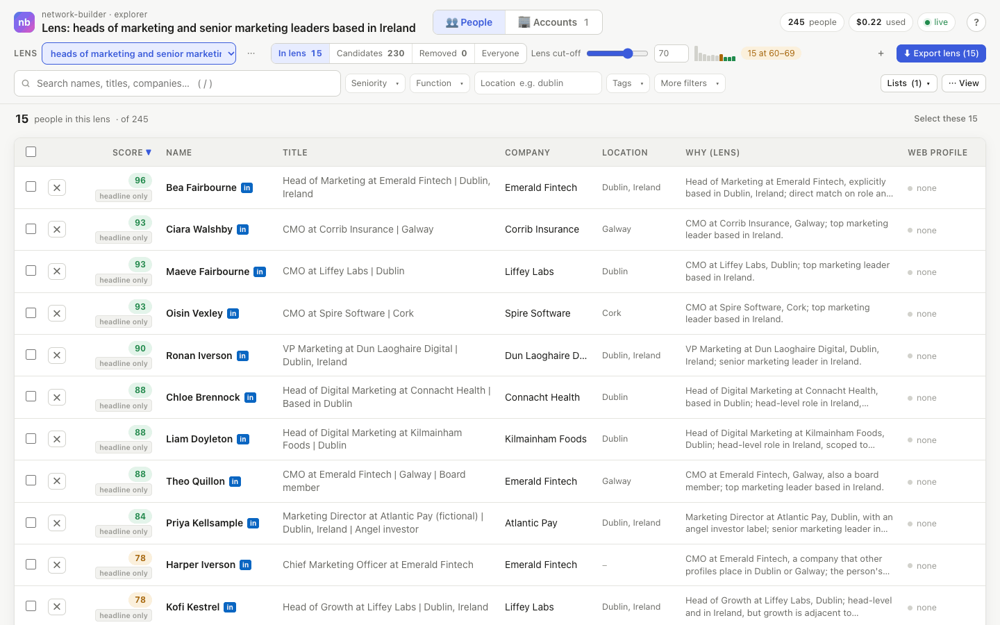
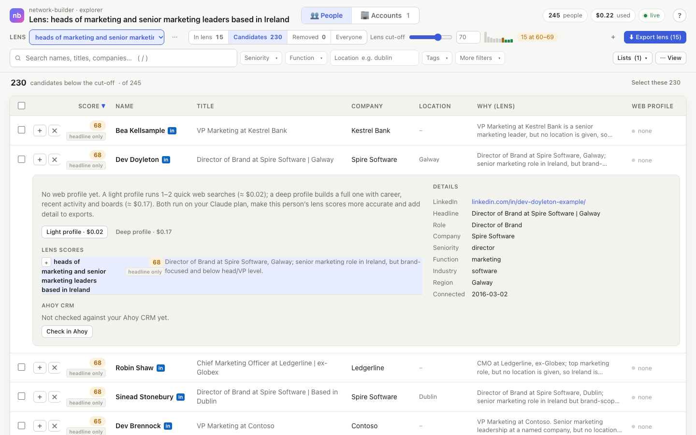
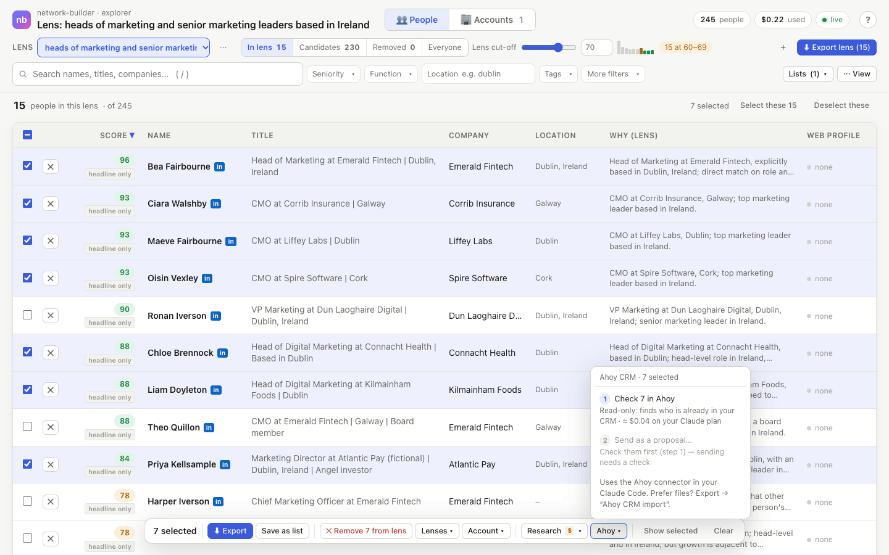
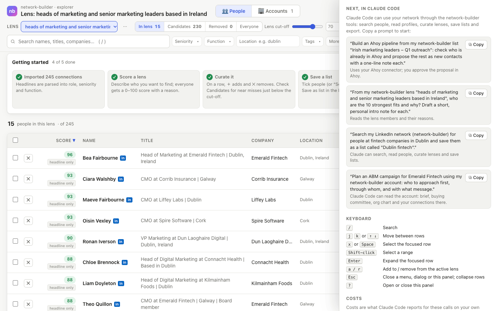

<div align="center">

# Network Builder

### Turn your LinkedIn network into a target list, and that list into your Ahoy pipeline.

Describe who you're after (*"senior marketing leaders at companies in Ireland"*). AI scores every connection 0–100 with
a reason. You trim the list, and Claude turns it into companies, contacts and deals in Ahoy for you to approve.

[](https://github.com/lyonsv/network-builder/releases)
[](LICENSE)
[](#-your-data)

</div>

## Install on a Mac

Open **Terminal** (press **⌘ Space**, type *Terminal*, press **Enter**), paste this line and press **Enter**:

```bash
curl -fsSL https://raw.githubusercontent.com/lyonsv/network-builder/main/install.sh | bash
```

**About 10 minutes.** It walks you through each step, and it's safe to run again if anything goes wrong.<br>
**You need** a Mac, Google Chrome and a Claude Pro or Max plan. No API key and nothing else to buy: AI work counts against
your Claude plan (importing 2,000 connections uses about $0.40 worth).<br>
**Your data stays on your Mac**, in `~/.network-builder`. [What it changes](#what-the-installer-changes) ·
[Uninstall](#uninstall) · [Read the script](install.sh)

<sub>Already use Claude Code? Paste this into it instead, and Claude does the setup with you:
`Set up network-builder for me by following https://raw.githubusercontent.com/lyonsv/network-builder/main/SETUP.md`</sub>

<picture>
  <source media="(prefers-color-scheme: dark)" srcset="docs/explorer-dark.png">
  
</picture>

<sub>Shown with made-up example data.</sub>

### What happens during setup

1. **Claude Code** is installed if you don't have it, and you log in.
2. **Network Builder** goes into Applications and your Dock, and Claude Code is connected to it.
3. **Chrome** opens its Extensions page with the folder path already copied. You switch on *Developer mode*, click
   *Load unpacked*, press ⌘⇧G and paste. <sub>(The connections exporter isn't in the Chrome Web Store, which is why
   Chrome calls it "unpacked". It only reads your Connections page when you click Start, and sends nothing anywhere.)</sub>
4. **LinkedIn** opens your Connections page. Click 🧩 → *LinkedIn Connections Exporter* → *Start export* and keep the
   tab in front (about a minute per 500 connections). Setup spots the file in Downloads and imports it.
   <sub>No Chrome, or a work laptop that blocks extensions? Choose LinkedIn's own export instead; it arrives by email.</sub>
5. **Ahoy** is checked. If it isn't connected to Claude yet, setup opens the page where you connect it (two clicks).

It ends with a checklist of what's done. Check again any time with `network-builder setup --status`.

<details id="what-the-installer-changes"><summary><b>What the installer changes on your Mac</b></summary>

- `~/.network-builder/`: your data, a private copy of Node.js (your own is never touched), the Chrome extension folders
- `~/.local/bin/network-builder`: the command, plus a PATH line in `~/.zshrc`
- `/Applications/Network Builder.app` (or `~/Applications`) and a Dock icon, on Apple silicon Macs
- `~/.claude/skills/network-builder` and a Claude Code connection called `network-builder` (all projects)
- Claude Code itself, if you didn't have it

No `sudo`, nothing in system folders.
</details>

<details id="uninstall"><summary><b>Uninstall</b></summary>

```bash
network-builder uninstall                 # keeps your network data
network-builder uninstall --delete-data   # removes everything
```

Then remove the extensions in `chrome://extensions`.
</details>

## 🚀 Your first 15 minutes

In Terminal, run **`network-builder claude`** to open Claude Code on your network (or just `claude`; if it was already
open, restart it so it picks up network-builder). Then ask:

> *Find the senior marketing leaders in my network based in Ireland and build an Ahoy pipeline of the target companies
> and people to reach out to.*

What Claude does, checking with you at each ★:

1. ★ Tells you the cost and asks before scoring your network for that goal (≈ $1–2 for 2,000 connections).
2. ★ Shows a shortlist grouped by company, each person with a score and a reason. You say who to cut.
3. ★ Asks which Ahoy pipeline to use, checks what's already in Ahoy, then sends the new companies, contacts, a deal per
   company and a "why them" note on each person as **proposals**. Nothing changes in Ahoy until you approve them there.

> [!NOTE]
> LinkedIn exports don't include where people are. "In Ireland" comes from what their headline says, and Claude marks it
> *stated* or *likely*. To confirm it, research those people in the app (a light profile, ≈ $0.02 each).

Other things to ask:

| | |
|---|---|
| **Find people** | *Who in my network could introduce me to someone at Northwind?* · *Which of my connections are angel investors?* |
| **Build lists** | *Save the top 20 as "Q1 outreach".* · *Remove the recruiters from my marketing lens.* |
| **Ahoy** | *Put my list "Q1 outreach" into Ahoy as deals in the Sales pipeline.* |
| **Accounts** | *Plan a campaign for Ledgerly: who decides, and what's my warm path in?* |

Claude does the free work (searching, curating, preparing proposals). Anything that costs money or changes Ahoy, it asks
first. Full list of what Claude can do: [docs/MCP.md](docs/MCP.md).

## 🧭 Using the app

Open **Network Builder** from your Dock. (Intel Mac? Run `network-builder` in Terminal; it opens the same app in your
browser.) Closing the window keeps it running; ⌘Q quits. A **Getting started** checklist walks you through the first
steps, and **?** (top right) opens help: a glossary, keyboard shortcuts, and prompts to copy into Claude Code.

### 1. Score your network for a goal

Click **＋** next to the lens picker (or **＋ New lens…** in it), type who you're looking for, for example
`Senior marketing decision makers (CMO, VP/Head/Director of Marketing, Brand, Growth) at companies in Ireland`, and
click **Create lens**. You see the cost and time first. A minute or two later everyone has a 0–100 score and a
one-line reason (**Why**). Typing a question into search offers the same thing.
Each goal is saved as a **lens**, and you can make as many as you like.

Be specific: *"Heads of marketing at B2B software companies in Ireland"* beats *"marketing people"*.


### 2. Trim the list

- **In lens** is everyone at or above the **Lens cut-off**; **Candidates** are below it. The chip next to the cut-off
  (e.g. *15 at 60–69*) shows the near misses worth a look.
- **✕** takes someone out for good (even after re-scoring); **＋** adds someone by hand. Keyboard: `j`/`k` move, `x`
  selects, `r` removes, `a` adds.
- Filter (search, seniority, function, location), then add or remove everyone you're looking at in one go.



### 3. Research the people who matter (optional, costs a little)

Select people, then **Research ▾ → Light profile** (≈ $0.02 each: who they are, roles, location) or **Deep profile** (≈ $0.17:
full career, plus what they've been talking about lately). It runs in the background. Their scores then update with
**↻ Update stale**.

### 4. Get it into Ahoy

- **Easiest:** save the people as a list (**Save as list**), then ask Claude: *"Put my list '…' into Ahoy as a
  pipeline"*. You get companies, contacts, a deal per company and notes, as proposals.
- **From the app:** select people → **Ahoy ▾** → **1 Check in Ahoy** (shows who's already there, ≈ $0.005 per person)
  → **2 Send as a proposal…** (new companies, contacts and a note on each; no deals).
- **As files:** **Export** → *Ahoy CRM import* gives Companies, Contacts and Notes CSVs. *CRM* gives HubSpot- and
  Salesforce-friendly columns.



### 5. Accounts: plan specific companies (optional)

Switch to **Accounts** to gather the key people at a company you're targeting: an org chart, who decides, who could
champion you, your warm paths in, and a brief. Then ask Claude *"Plan a campaign for Ledgerly"*. The optional
**Network Builder for LinkedIn** Chrome button adds people straight from their LinkedIn profile, connection or not.
[More about Accounts →](docs/accounts.md) · [Map a company's marketing team →](docs/marketing-org-map.md)



### 6. Add new connections later

Run the exporter on LinkedIn again, then **File → Import Connections CSV…** in the app (or
`network-builder import ~/Downloads/<file>.csv`). New people are added and job titles refreshed.

<details><summary><b>Words you'll see</b></summary>

- **Lens**: a saved goal, with everyone scored 0–100 against it.
- **Cut-off**: the score at which people count as *in* the lens. **In lens / Candidates / Removed**: above it / below
  it / people you took out.
- **Headline only**: scored from their LinkedIn headline alone, before any web research.
- **Light / deep profile**: web research on one person (quick and cheap / thorough).
- **Stale**: their info changed since they were scored; **↻ Update stale** re-scores just them.
- **Proposal**: a batch of changes waiting for your approval in Ahoy.
- **Account**: a company you're targeting, with its key people (account-based marketing, ABX).
</details>

## 💸 What things cost

Everything runs through Claude Code on your Claude plan, so there's no separate bill; it counts towards your plan's usage
limits. Dollar figures are what the same work would cost on the API, so you can compare.

| | Cost |
|---|---|
| Import (Claude reads each headline: role, seniority, industry) | ≈ $0.20 per 1,000 connections |
| A lens (score everyone, then double-check the top 150) | ≈ $0.30 per 1,000 + ≈ $0.75 |
| Light / deep web profile | ≈ $0.02 / ≈ $0.17 per person |
| Ahoy check | ≈ $0.005 per person |
| Asking Claude, curating, lists, exports, preparing Ahoy proposals | free |

## 🔐 Your data

- **It stays on your Mac**, in `~/.network-builder/` (`network.db`, plus exports in `outputs/`).
- **What leaves it:** only the AI calls Claude Code makes for you. Headlines go to Claude for scoring; names, titles and
  companies go into web searches for profiles **you** start; the people you send to Ahoy go to your own Ahoy.
- The app listens on `127.0.0.1` only, with a per-session token, so other websites can't trigger anything.
- Your connections are personal data. Use exports responsibly and in line with LinkedIn's terms and your local privacy
  law. If you contact someone you found through research, tell them where you got their details (GDPR Art. 14).

<details><summary><b>Troubleshooting</b></summary>

- **Start here:** `network-builder setup --status` shows what's working and what to do about the rest. Running setup
  again (`network-builder setup`, or the install line) fixes most things.
- **Claude can't see my network** (no `network_*` tools): restart Claude Code (`/exit`, then `network-builder claude`).
- **"Not logged in"**: run `claude auth login`.
- **The app won't open, or macOS says it's damaged**: `xattr -dr com.apple.quarantine "/Applications/Network Builder.app"`.
- **The exporter finds no connections**: LinkedIn has to be in English. Reload the Connections page and start again.
- **LinkedIn shows a security check**: stop and try again tomorrow.
- **Profiles show "paused (rate limit)"**: web search is rate-limited on your plan. It backs off by itself; if it keeps
  happening, it waits for you to click **Resume**.
- **"Identity not confirmed" on a light profile**: two searches weren't enough (common for less public people). Use a
  deep profile for the people who matter.

</details>

<details><summary><b>Other ways to install</b> (Linux, npm, by hand)</summary>

- **Linux, or you already have Node.js 22.13+:** `npx github:lyonsv/network-builder` imports a CSV and opens the app in
  your browser. Connect Claude Code with `claude mcp add -s user network-builder -- npx -y github:lyonsv/network-builder mcp`
  and copy `skills/network-builder` to `~/.claude/skills/`.
- **The desktop app by hand:** download `Network-Builder-mac-arm64.zip` from the
  [latest release](https://github.com/lyonsv/network-builder/releases/latest), unzip it into Applications. It isn't
  signed, so the first time, right-click it and choose **Open**.
- **Connections without the extension:** LinkedIn → **Settings → Data privacy → Get a copy of your data →
  Connections**. Any CSV with name and title columns works too: `network-builder import <file>`.
- **The connections exporter by hand:** [chrome-linkedin-connections-exporter](https://github.com/lyonsv/chrome-linkedin-connections-exporter).

</details>

<details><summary><b>Command-line reference</b></summary>

| Command | What it does |
|---|---|
| `network-builder` | Open the app in your browser (guided import if you have no data yet) |
| `network-builder setup [--status] [--agent]` | Set everything up, or check it (safe to run again) |
| `network-builder claude ["question"]` | Open Claude Code on your network |
| `network-builder import <csv> [-p "goal"]` | Import or refresh connections, and optionally score a lens |
| `network-builder -p "goal"` | Create a lens (or update stale scores), then open it |
| `network-builder lists` · `export --list <name> [--preset crm\|full\|ahoy]` | Saved lists, and export one to CSV |
| `network-builder lens list` · `lens rescore <lens> [--goal …] [--stale]` · `lens rm <lens>` | Manage lenses |
| `network-builder db` | Database stats and total spend |
| `network-builder mcp` | The MCP server Claude Code uses ([docs](docs/MCP.md)) |
| `network-builder uninstall [--delete-data]` | Remove it |

Options: `--db <path>`, `-o/--out-dir <path>`, `--research-model <model>` (default `sonnet`), `-c/--concurrency <n>`,
`--light-concurrency <n>`, `--rerank-top <n>` (default 150), `--no-open`, `--port <n>`, `--no-serve`, `--dry-run`. Set
`NETWORK_BUILDER_HOME` to keep data elsewhere.

</details>

## 🛠️ Development

```bash
git clone https://github.com/lyonsv/network-builder && cd network-builder
pnpm install
pnpm dev                 # run from source
pnpm typecheck && pnpm test && pnpm build
cd desktop && pnpm install && pnpm build    # the Mac app
scripts/release-assets.sh                   # release files the installer downloads
```

- **The app's UI** is one dependency-free HTML file (`src/web/explorer.html`) served by a small `node:http` server;
  the API and data model are in `src/web/CONTRACT.md`.
- **AI calls** go through `claude -p` with JSON schemas (`src/llm/`). **Setup** is `src/setup/`. Architecture and
  product rules: [AGENTS.md](AGENTS.md).

Issues and pull requests are welcome. Requires Node.js 22.13+.

## License

[MIT](LICENSE) © Vincent Lyons
