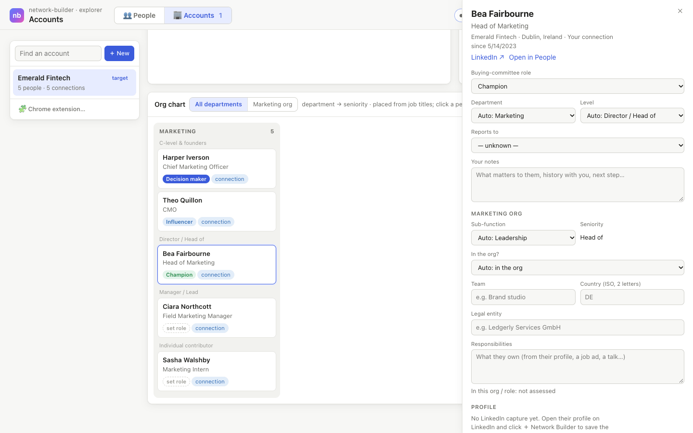

# Accounts (ABX) and the Chrome extension

[← README](../README.md)

Switch the explorer to **Accounts** (top right) to work account by account:

- **Account:** a company you're targeting. It has a status (target, engaged, customer, paused), a domain, its LinkedIn
  page, aliases, and an **ABX brief** in markdown (why now, pains, triggers, angle, plan). The brief autosaves.
- **Org chart:** the key people, grouped by department → seniority. Each person is placed automatically from their
  job title; click someone to correct it, set their **buying-committee role** (decision maker, champion, influencer,
  end user, gatekeeper, blocker), who they **report to**, and notes.
- **Coverage and gaps:** e.g. "no decision maker", "nobody at VP level or above", "no warm path".
- **Warm paths:** your connections who work there now (one click adds them), or used to.
- **⧉ Copy for AI:** the whole account as one markdown document.

Ways to add people:
1. **From LinkedIn** with the [Chrome extension](../extension/README.md). Click **＋ Network Builder** on any profile,
   connection or not. The full profile (about, experience with descriptions, education, skills) is saved. People who
   aren't connections stay under the account and never enter your network, lenses or exports.
   To map a whole team, run a LinkedIn people search (e.g. "marketing" at that company) and click
   **⇣ Map to Network Builder** (see [Map a marketing org](marketing-org-map.md) below). It reads the visible list in
   that tab only after you press Start, at human pace,
   up to 300 rows a run (500 max) and 1,000 a day, and stops on any LinkedIn security check or limit page.
   Everyone it sees is saved as a light contact (name, headline, link); "LinkedIn Member" rows are kept only as counts.
   Full profiles stay one click per person. LinkedIn's terms restrict automated browsing, so use it sparingly.
2. **From your network.** Select people in **People**, then **Add to account ▾**.
3. **From Claude**, with `network_account_add_people`.

Then ask Claude Code: *"Plan an ABX campaign for Ledgerly"* (the `abx_campaign` prompt). It calls `network_get_account`,
which returns the brief, buying committee, org chart, full profiles and warm paths in one go.

